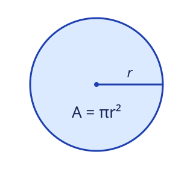

# Geometry

## Question

What is the area of a circle?

## Answer

$A=πr^2$

## Question

What are some examples of quadrilaterals?

## Answer

Any 4-sided shape

- Squares 
- Rectangles 
- Diamonds 
- Trapezoids 
