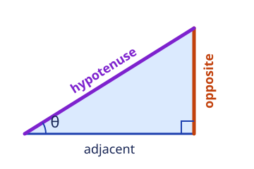
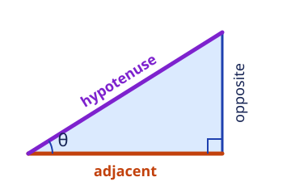
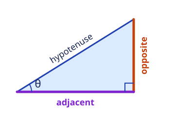

# Geometry

## Question

What is the area of a circle?

## Answer

$A = \pi r^2$

## Question

What are some examples of quadrilaterals?

## Answer

A polygon with four sides

- Squares 
- Rectangles 
- Rhombuses 
- Trapezoids 

## Question

What is the sine ratio in a right triangle?

## Answer

$\sin(\theta) = \frac{\text{opposite}}{\text{hypotenuse}}$

## Question

What is the cosine ratio in a right triangle?

## Answer

$\cos(\theta) = \frac{\text{adjacent}}{\text{hypotenuse}}$

## Question

What is the tangent ratio in a right triangle?

## Answer

$\tan(\theta) = \frac{\text{opposite}}{\text{adjacent}}$

